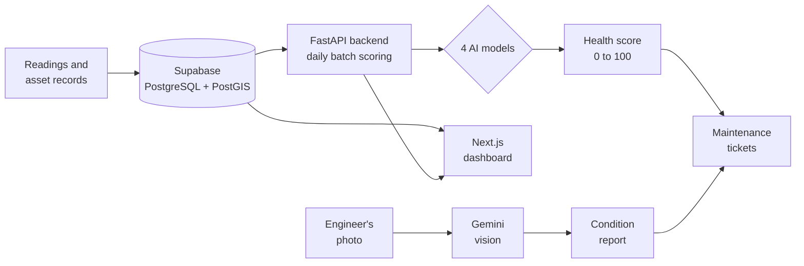

<div align="center">


# Belaku Kannu
### ಬೆಳಕು ಕಣ್ಣು

**An AI eye on every distribution transformer.**<br/>
Predict failures, explain the risk, read field photos, and turn findings into tickets.

<br/>


[Demo access](#demo-access) · [How it works](#how-it-works) · [Quick start](#quick-start-local) · [API](#api-overview) · [Limitations](#limitations-and-roadmap)

</div>

---

## The problem

Distribution transformers are usually repaired **after** they fail. That means unplanned outages, emergency repair costs, and field crews sent where the fault already happened instead of where it is about to happen.

## The solution

Belaku Kannu moves transformer maintenance from **run-to-failure** to **predict-and-prevent**.

| | Step | What happens |
|:-:|---|---|
| 1 | **Score** | Four AI models give every transformer a 0–100 health score |
| 2 | **Explain** | SHAP shows which readings (temperature, load, voltage...) drive the risk |
| 3 | **See** | An engineer uploads a field photo and gets an AI condition report |
| 4 | **Act** | Risky transformers raise maintenance tickets automatically, or from a photo report |
| 5 | **Monitor** | A live dashboard shows a risk-ranked list and a network map |

## Features

| Feature | Page | What it does |
|---|---|---|
| **Dashboard** | `/dashboard` | Fleet health cards, risk-ranked list, filters, CSV export |
| **Network map** | `/map` | Transformers on a map, colored by status |
| **Transformer detail** | `/dashboard/transformers/[id]` | 24h telemetry, health score, SHAP risk drivers, forecast |
| **AI analytics** | `/ml-analytics` | Confusion matrices, ROC curves, classification reports, LSTM forecast |
| **Photo inspection** | `/dashboard/inspection` | Upload a photo → AI condition report → optional ticket |
| **Tickets** | `/dashboard/tickets` | Auto and manual maintenance tickets, resolved with notes and outcome |

## Demo access

Open the app at http://localhost:3000 and choose one:

| Option | How |
|---|---|
| **Sign in** | Click **Sign in** and use the demo account below |
| **Guest** | Click **Continue as guest**. No account needed |

```text
Email:     demo@belakukannu.com
Password:  BelakuKannu@2026
```

> [!NOTE]
> This is a shared **demo-only** account for judges. It holds no real data and is not a production credential. It lives in the project's Supabase Auth, so a fresh Supabase project needs it created once: **Authentication → Users → Add user**, and tick **Auto Confirm User**.

## How it works



About 30 seconds after the backend starts, a daily batch job scores every transformer, saves the results, and creates tickets for risky ones. The dashboard reads transformers from Supabase; tickets, analytics and photo inspection come from the backend.

### Health score

Four models are blended into one score (code: `backend/services/ai_service.py`):

```text
Health Score = 0.50 × Cox survival health
             + 0.35 × best supervised classifier (XGBoost / Random Forest)
             + 0.15 × Isolation Forest health
```

If a component is unavailable, its weight is redistributed to the others.

| Model | Type | Role |
|---|---|---|
| **Isolation Forest** | Unsupervised | Flags abnormal behaviour |
| **XGBoost** and **Random Forest** | Supervised | Classify SAFE / WARNING / CRITICAL |
| **Cox Proportional Hazards** | Survival analysis | Estimates remaining life |
| **SHAP** | Explainability | Shows which inputs drive a prediction |
| **LSTM (PyTorch)** | Time series | 24h load and temperature forecast |

### Photo inspection (multimodal AI)

An engineer uploads a photo (oil leak, rust, bushing damage, thermal image). The backend sends it to **Google Gemini (free tier)**, which returns a structured report:

- **Condition:** GOOD, FAIR, POOR, CRITICAL or UNCLEAR
- **Urgency**, **findings** with severity, **suggested actions**, **confidence**, and what it **could not assess**

If a transformer code is given, the model also receives that transformer's size, age and health score as context, and the report becomes a ticket in one click.

> [!WARNING]
> This is decision support from a single photo, **not a replacement for a physical inspection**. Photos are sent to Google's API, so don't upload sensitive images.

## Data: please read

> [!IMPORTANT]
> Real per-transformer sensor data is not public, so this prototype uses **synthetic data**. The ~99% classifier accuracy below reflects that synthetic data, **not real-world performance**.

- **Readings and labels** are generated from physics-based formulas, calibrated to **published Indian DISCOM statistics** (APDCL audit figures: AT&C loss, unmetered share, failure rate).
- **Locations** come from OpenStreetMap proxy points and a simulated "digital twin".
- The bundled seed data is placed in Assam. `backend/data/seed_transformers_bengaluru.csv` is the same fleet placed across 20 Bengaluru areas.
- The pipeline is built so real SCADA or meter data can replace the synthetic dataset.

| Model | Accuracy | F1 | ROC-AUC |
|---|:-:|:-:|:-:|
| Random Forest | 99.65% | 0.9965 | 0.9999 |
| XGBoost | 99.50% | 0.9950 | 1.0000 |

<sub>10,000 synthetic samples, 80/20 split, 3 classes.</sub>

## Tech stack

| Layer | Technology |
|---|---|
| **Frontend** | Next.js 16, React 19, TypeScript, Tailwind CSS, Recharts, Leaflet |
| **Backend** | FastAPI, SQLAlchemy 2, Alembic, Python 3.11 |
| **Database** | PostgreSQL + PostGIS (Supabase) |
| **ML** | scikit-learn, XGBoost, lifelines, SHAP, PyTorch |
| **Multimodal AI** | Google Gemini API (free tier) |
| **CI** | GitHub Actions (ruff, pytest, TypeScript check) |

## Quick start (local)

**Prerequisites:** Python 3.11, Node.js 20+, and a PostgreSQL database with PostGIS. A free [Supabase](https://supabase.com) project works; enable the `postgis` extension.

### 1. Backend

```bash
cd backend
python3.11 -m venv .venv && source .venv/bin/activate
pip install -r requirements.txt

cp ../.env.example .env        # then edit: DATABASE_URL, JWT_SECRET_KEY, GEMINI_API_KEY
alembic upgrade head           # create tables
python scripts/seed_db.py      # load transformers and substations
```

Trained model files (`*.pkl`) are not stored in git. Generate them once:

```bash
python scripts/generate_datasets.py
python scripts/train_production_models.py
```

Start the API:

```bash
uvicorn main:app --port 8000
```

- Swagger docs: http://localhost:8000/api/docs
- Health check: http://localhost:8000/health

### 2. Database view for the dashboard

The dashboard reads a flat view from Supabase. In the Supabase **SQL Editor**, run `backend/scripts/supabase_views.sql`.

### 3. Frontend

```bash
cd frontend
touch .env.local               # then add the variables below
npm install
npm run dev                    # http://localhost:3000
```

`frontend/.env.local`:

```env
NEXT_PUBLIC_SUPABASE_URL=https://YOUR-PROJECT.supabase.co
NEXT_PUBLIC_SUPABASE_ANON_KEY=your_publishable_key
NEXT_PUBLIC_API_URL=http://localhost:8000/api/v1
NEXT_PUBLIC_WS_URL=ws://localhost:8000
```

> [!NOTE]
> **Demo mode:** login is bypassed in the dashboard (`frontend/src/components/AuthGuard.tsx` and `backend/api/api.py`) so judges can open it directly. Restore the checks before any real deployment.

### Backend environment variables

Set these in `backend/.env`. Never commit `.env` files; they are git-ignored.

| Variable | Purpose |
|---|---|
| `DATABASE_URL` | PostgreSQL connection string (e.g. Supabase) |
| `JWT_SECRET_KEY` | Secret for tokens (`openssl rand -hex 32`) |
| `GEMINI_API_KEY` | Free key from [Google AI Studio](https://aistudio.google.com), for photo inspection |
| `GEMINI_MODEL` | Optional. Defaults to `gemini-3.1-flash-lite`; change if Google retires it |

## API overview

All routes are under `/api/v1`.

<details>
<summary><b>Show all endpoints</b></summary>

<br/>

| Method | Endpoint | Description |
|:-:|---|---|
| `GET` | `/transformers/` | List transformers |
| `GET` | `/transformers/{id}/detail` | Full detail for one transformer |
| `GET` | `/transformers/{id}/timeseries` | Telemetry history |
| `GET` | `/transformers/{id}/shap-explanations` | Risk drivers |
| `GET` | `/transformers/{id}/forecast` | Load and temperature forecast |
| `GET` | `/substations/` · `/feeders/` | Network assets |
| `GET` | `/operations/tickets` | List tickets (`?status=OPEN`) |
| `POST` | `/operations/tickets/{id}/resolve` | Resolve a ticket |
| `POST` | `/inspection/analyze` | Photo inspection (multipart: `image`, optional `transformer_code`, `notes`) |
| `POST` | `/inspection/ticket` | Raise a ticket from an inspection report |
| `GET` | `/ml/benchmark` | Model benchmark results |
| `GET` | `/ml/deep-learning` | LSTM results |
| `WS` | `/ws/notifications` | Live notifications |

</details>

## Project structure

<details>
<summary><b>Show the folder layout</b></summary>

```text
belaku-kannu/
├── backend/
│   ├── main.py                    # FastAPI entry point
│   ├── api/endpoints/             # asset, detail, intelligence, operations (tickets),
│   │                              #   inspection (photo AI), ml_analytics, websockets ...
│   ├── services/                  # ai_service (scoring + fusion), ml_benchmark,
│   │                              #   deep_learning (LSTM), inference_service
│   ├── scripts/                   # seed_db, generate_datasets, train_production_models,
│   │                              #   predict_daily_batch, supabase_views.sql
│   ├── models/ · schemas/ · crud/ # SQLAlchemy models, Pydantic schemas, DB operations
│   ├── alembic/                   # database migrations
│   ├── ml_models/                 # benchmark results, LSTM weights (.pkl files generated locally)
│   └── tests/
├── frontend/
│   ├── public/logo.png
│   └── src/
│       ├── app/                   # landing, login, dashboard, map, ml-analytics,
│       │                          #   dashboard/inspection, dashboard/tickets, dashboard/settings
│       ├── components/            # layout, widgets, map, forms
│       └── lib/                   # API client, Supabase client
├── data-pipeline/                 # synthetic "digital twin" data generation (OSM + weather)
├── .github/workflows/             # CI
└── docker-compose.yml             # optional containerised setup (not verified for this release)
```

</details>

## Limitations and roadmap

| Limitations (honest list) | Next steps |
|---|---|
| Synthetic data; not validated against real BESCOM failure records | Plug in real SCADA / meter data and retrain on failure-labeled records |
| No integration with BESCOM's existing operational systems | Ticket assignment, due dates and status tracking |
| Tickets are not assigned to engineers; no SMS / WhatsApp alerts | SMS / WhatsApp alerts when a transformer turns critical |
| Login is bypassed in demo mode | Pilot on one division, then scale |

## License

MIT. See [LICENSE](LICENSE).

---

<div align="center">
<sub>Built for <b>BESCOM POWER HACK 2026</b> · Presidency University, Bengaluru</sub>
</div>
